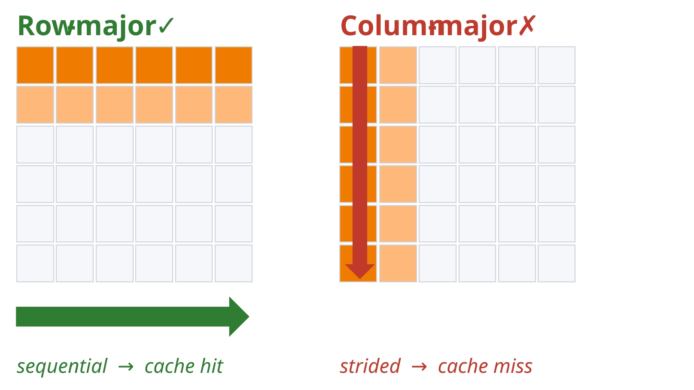
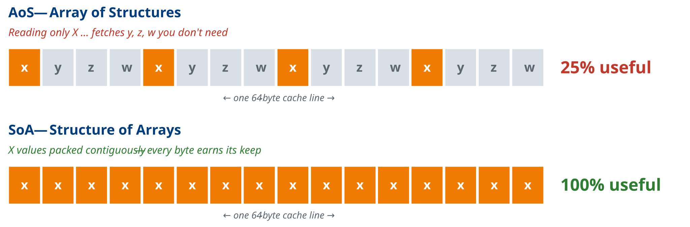
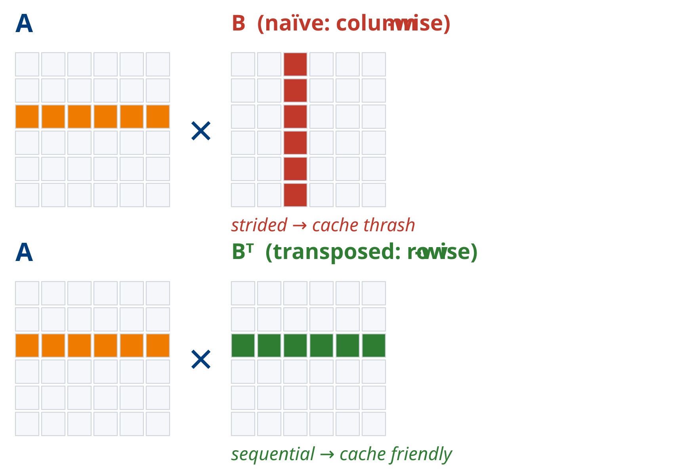
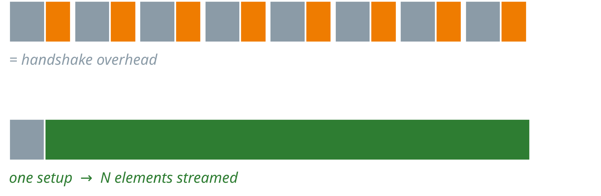

# Hardware Acceleration & Memory Access Examples

Code examples that illustrate hardware acceleration concepts, memory access patterns and number representation, with parallels across CPU, GPU and FPGA platforms.

All examples are AI-generated. The repository is [here](https://github.com/NUS-CEG5203/nus-ceg5203.github.io/tree/main/docs/Accel_Examples).

---

## 1. `col_row_maj_cache.c`

**Summary:** Allocates a 2D matrix and times row-major and column-major traversal.

**Significance:** Shows the effect of spatial locality on CPU cache performance. Row-major traversal is sequential (matching how C lays out 2D arrays) and uses every word of each cache line. Column-major traversal strides across rows, so each fetch yields one useful word and latency rises sharply. This is analogous to DDR on FPGAs, where sequential AXI bursts are far more efficient than strided accesses.



**How to Run:**
```bash
gcc -O2 -o col_row_maj_cache col_row_maj_cache.c
./col_row_maj_cache
```
*Dependencies: standard C library only.*

---

## 2. `aos_vs_soa.c`

**Summary:** Compares Array of Structures (AoS) and Structure of Arrays (SoA) layouts when summing one field (x) over 64 million elements.

**Significance:** When only one field of a four-field struct is read, AoS wastes 75% of each cache line on unused fields (y, z, w), while SoA keeps the needed field contiguous. The same trade-off drives BRAM layout and memory-bank choices in HLS and FPGA data paths.



**How to Run:**
```bash
gcc -O2 -o aos_vs_soa aos_vs_soa.c
./aos_vs_soa
```
*Dependencies: standard C library only.*

---

## 3. `matrix_transpose_optimization.c`

**Summary:** Benchmarks naive matrix multiplication (column-wise access of B) against a version that first transposes B so the inner loop reads both operands sequentially.

**Significance:** The naive inner loop steps through B with a stride of N elements and misses the cache on almost every access. The transpose costs one extra O(N²) pass but removes O(N³) cache misses, which is counter-intuitive but a clear net win. The FPGA equivalent is adding a reshape or tiling stage that costs area but enables a tight, pipelined inner dataflow.



**How to Run:**
```bash
gcc -O2 -o matrix_transpose matrix_transpose_optimization.c
./matrix_transpose
```
*Dependencies: standard C library only.*

---

## 4. `gpu_demo.c`

**Summary:** Uses OpenCL to run a 1024×1024 matrix multiplication and a 10M-element vector multiplication on a GPU, each compared with a CPU baseline.

**Significance:** Contrasts compute-bound and memory-bound workloads using **arithmetic intensity**, the FLOPs performed per byte moved.
- *Compute-bound* (matrix multiply, O(N³) work on O(N²) data): each fetched byte is reused many times, so the GPU's ALUs stay busy and the speedup is large.
- *Memory-bound* (element-wise multiply): one multiply per load, so PCIe transfer and DRAM/AXI bandwidth dominate, the ALUs sit idle, and the speedup is small.

Arithmetic intensity is the key predictor of how much a GPU or FPGA accelerator will help.

**How to Run:**
```bash
gcc -O2 -o gpu_demo gpu_demo.c -lOpenCL
./gpu_demo
```
*Dependencies: OpenCL runtime and ICD loader (`libOpenCL`), and a GPU with an OpenCL 1.2+ driver. On Ubuntu: `sudo apt install ocl-icd-opencl-dev`.*

---

## 5. `coalesced_vs_noncoalesced.c`

**Summary:** Runs two OpenCL matrix multiplication kernels, one with coalesced and one with non-coalesced global memory access, and reports the kernel time of each.

**Significance:** On GPUs (and FPGA HBM/DDR), coalescing merges the memory requests of neighbouring work-items into one wide transaction. The non-coalesced kernel indexes A and B transposed, which forces many narrow transactions and cuts effective bandwidth. Falls back to OpenMP on the CPU if no GPU is found. This mirrors AXI burst vs. random access in FPGA design.

Note: `matmul_opencl.c` is the same program (identical apart from its header comment).

**How to Run:**
```bash
gcc -O2 -fopenmp -o coalesced_vs_noncoalesced coalesced_vs_noncoalesced.c -lOpenCL
./coalesced_vs_noncoalesced [matrix_size]   # default N=1024
```
*Dependencies: OpenCL runtime and ICD loader (`libOpenCL`); OpenMP (included in GCC).*

---

## 6. `vadd_comparison.cpp`

**Summary:** Two HLS-annotated vector addition kernels, a simple single-element version and a burst-optimised version with local ping-pong buffers, benchmarked in software simulation.

**Significance:** The burst kernel stages data through local buffers in chunks of 64 elements, mimicking the read–compute–write pattern HLS uses to infer pipelined AXI bursts. The `#pragma HLS` directives (`m_axi`, `PIPELINE`, `ARRAY_PARTITION`) show where annotations go, but the file is for desktop runs only: its dummy file-scope pragmas make Vitis HLS reject it. The synthesisable versions are `kernel.cpp` and `kernel_burst.cpp` (section 9).

The burst version will most likely run *slower* on a CPU. Why? The CPU already prefetches cache lines, so the extra copies are pure overhead. The same idea appears on every platform:

| Platform | Mechanism |
|---|---|
| CPU | cache-line prefetch |
| GPU | coalesced warp loads |
| FPGA | AXI burst reads |

All three answer the same question: pay the setup cost once, then stream.



**How to Run:**
```bash
g++ -O2 -o vadd_comparison vadd_comparison.cpp
./vadd_comparison
```
*Dependencies: standard C++ library only.*

---

## 7. `sum_halves.cpp`

**Summary:** An HLS kernel that reads 2048 integers from BRAM and writes 1024 outputs, each the average of one element from each half of the input.

**Significance:** A minimal HLS design exercise. `#pragma HLS PIPELINE` targets an initiation interval (II) of 1. The commented-out `ARRAY_PARTITION` pragma and the alternative three-way average let you explore how BRAM port conflicts limit pipeline throughput and how array partitioning resolves them. See the Lecture 13B recording for a live demo.

**How to Run:**
```bash
source ~/Xilinx/2025.1/Vitis/settings64.sh   # adjust to your install; sets $XILINX_VITIS

# Synthesis for the KV260 part
v++ -c --mode hls --part xck26-sfvc784-2LV-c --hls.flow_target vivado \
    --hls.syn.file sum_halves.cpp --hls.syn.top sum_halves --hls.clock 10ns --work_dir sum_halves
# Report (check the achieved II): sum_halves/hls/syn/report/sum_halves_csynth.rpt
```
*Dependencies: Vitis HLS 2025.1 (`v++`). There is no `main()` or testbench, so this cannot be built as an executable; `g++ -c sum_halves.cpp` only checks syntax.*

---

## 8. Tiled OpenCL Matrix Multiplication — `matmul_*.c`

**Summary:** Three variants of a tiled OpenCL matrix multiplication (the `matmul_tiled` kernel stages tiles of A and B in `__local` memory). Each runs on the GPU, then on an OpenCL CPU device (or a host fallback if none exists), and prints a GPU-vs-CPU summary.

| File | CPU fallback | Tile size |
|---|---|---|
| `matmul_opencl _CPU fallback.c` | Plain C (single-threaded) | Command line (default 16) |
| `matmul_openmp.c` | OpenMP (multi-threaded) | Command line (default 16) |
| `matmul_opencl_autoselTileSize.c` | OpenMP (multi-threaded) | Auto-tuned from {8, 16, 32, 64}, limited by the device's max work-group size |

**Significance:** Tiling is how GPUs (and FPGA designs, via BRAM buffers) reuse data: each element loaded into a local tile is used `tile` times instead of once, raising arithmetic intensity (see `gpu_demo.c`). The two fallbacks show how much of the GPU's advantage a multi-core CPU recovers. The auto-tuner shows that the best tile size is hardware-dependent, trading local-memory capacity and work-group limits against reuse, just as tile and partition sizes are chosen in HLS.

**How to Run:**
```bash
# Plain C fallback (filename contains a space)
gcc -O2 -o matmul_cpu_fallback "matmul_opencl _CPU fallback.c" -lOpenCL
./matmul_cpu_fallback [N] [tile]          # defaults: N=1024, tile=16

# OpenMP fallback
gcc -O2 -fopenmp -o matmul_openmp matmul_openmp.c -lOpenCL
./matmul_openmp [N] [tile]

# Auto-selected tile size
gcc -O2 -fopenmp -o matmul_autotile matmul_opencl_autoselTileSize.c -lOpenCL
./matmul_autotile [N]
```
*Dependencies: OpenCL runtime and ICD loader (`libOpenCL`); OpenMP (included in GCC). Tile size must be ≤ 64 (the size of the `__local` arrays) and `tile²` must not exceed the device's max work-group size.*

---

## 9. HLS Vector Addition Kernels — `kernel.cpp`, `kernel_burst.cpp`, `test_Kernel.cpp`

**Summary:** Two Vitis HLS versions of a vector addition kernel `vadd`, plus a testbench.
- `kernel.cpp`: a single pipelined loop (`II=1`) reading A and B and writing C through one shared `m_axi` bundle (`gmem`), with `s_axilite` control.
- `kernel_burst.cpp`: separate `m_axi` bundles per array (`gmem0/1/2`) and a read → compute → write loop over 64-element chunks in fully partitioned local buffers.
- `test_Kernel.cpp`: runs `vadd` on 256 elements, compares against a software reference and prints PASSED/FAILED.

**Significance:** These are the synthesisable counterparts of `vadd_comparison.cpp`. Synthesise both and compare the reports (latency, AXI burst inference, resources) to see how separate AXI bundles and local buffering let the tool infer long bursts and use the ports in parallel.

**How to Run:**
```bash
source ~/Xilinx/2025.1/Vitis/settings64.sh   # adjust to your install; sets $XILINX_VITIS

# C simulation (burst kernel + testbench)
g++ -O2 -I$XILINX_VITIS/include -o tb_vadd_burst kernel_burst.cpp test_Kernel.cpp
./tb_vadd_burst

# Synthesis for the KV260 part: run both and compare the reports
v++ -c --mode hls --part xck26-sfvc784-2LV-c --hls.flow_target vivado \
    --hls.syn.file kernel_burst.cpp --hls.syn.top vadd --hls.clock 10ns --work_dir vadd_burst
v++ -c --mode hls --part xck26-sfvc784-2LV-c --hls.flow_target vivado \
    --hls.syn.file kernel.cpp --hls.syn.top vadd --hls.clock 10ns --work_dir vadd_simple
# Reports: vadd_burst/hls/syn/report/vadd_csynth.rpt, vadd_simple/hls/syn/report/vadd_csynth.rpt
```
*Dependencies: Vitis HLS 2025.1 (`v++`; the kernels include `ap_int.h` and `hls_stream.h` from `$XILINX_VITIS/include`). `test_Kernel.cpp` declares the `kernel_burst.cpp` signature (`volatile int*`); to test `kernel.cpp`, change the declaration to `extern "C" void vadd(const int*, const int*, int*, int)`.*

---

## 10. OpenCL Sobel Edge Detection — `sobel_*`

**Summary:** Three OpenCL implementations of a 3×3 Sobel filter on an 8-bit greyscale image, plus host programs that time them.

| File | Role |
|---|---|
| `sobel_naive.cl` | Each work-item reads its 9 neighbouring pixels directly from global memory |
| `sobel_tiled.cl` | Each work-group cooperatively loads a tile plus a 1-pixel halo into `__local` memory, then computes from it |
| `sobel_image.cl` | Uses `image2d_t` objects and a sampler, so the GPU's texture cache and hardware edge clamping handle memory access |
| `sobel_host.c` | Host program comparing the naive and tiled kernels (loads the `.cl` files at runtime) |
| `sobel_all_host.c` | Host program comparing all three kernels on a 1024×1024 random image |
| `run_sobel_all_host.sh` | Builds and runs `sobel_all_host` |
| `sobel_image_host.c` | Code fragment (not a full program) showing the image-object setup for `sobel_image.cl` |

**Significance:** A stencil like Sobel reads each input pixel 9 times. The naive kernel fetches all 9 from global memory; the tiled kernel fetches each pixel once per work-group and reuses it from on-chip memory, the same idea as line and window buffers in HLS image processing. The image version is a third option: rely on dedicated cache hardware instead of managing on-chip memory explicitly.

**How to Run:**
```bash
# Naive vs tiled (run from this directory so the .cl files are found)
gcc -O2 -o sobel_host sobel_host.c -lOpenCL -lm
./sobel_host [width] [height] [block]

# All three kernels
bash run_sobel_all_host.sh
```
*Dependencies: OpenCL runtime and ICD loader (`libOpenCL`) with a GPU device; `sobel_image.cl` needs image support (OpenCL 1.2+). `sobel_all_host` uses a fixed 1024×1024 image with 16×16 work-groups, so the arguments in `run_sobel_all_host.sh` are ignored.*

---

## 11. `number_formats.c`

**Summary:** Four short predict-observe-explain demos on number representation. Each demo shows the code, asks you to predict the result, waits for Enter, then prints the result and asks you to explain it.

| Demo | Topic | What it shows |
|---|---|---|
| 1 | Bits of a float | The 32 bits of `-9.875f` read as an integer (`0xC11E0000`). Students work out how that relates to the value |
| 2 | 8-bit fixed point (value = integer / 128) | `(0.1 + 0.2) - 0.3` evaluates to -1 LSB, not 0, because each conversion truncates toward zero and the errors accumulate |
| 3 | 16-bit fixed point (value = integer / 256) | 1.5 × 1.5 stored in an `int16_t` product overflows and gives 0.25 instead of 2.25. The fix is a wider (32-bit) intermediate |
| 4 | Floating-point addition | `(a + b) + c` ≠ `a + (b + c)` for `1e30, -1e30, 1.0`: the 1.0 is absorbed |

**Significance:** Hardware choices about word length and number format decide accuracy, area and speed. Fixed point is cheap on FPGAs but requires you to track scaling, rounding and intermediate widths yourself. Floating point is convenient but not associative, so parallel or reordered reductions (as on GPUs and in pipelined HLS) can change the result.

**How to Run:**
```bash
gcc -o number_formats number_formats.c
./number_formats          # all demos in order
./number_formats 2        # a single demo
```
*Dependencies: standard C library only.*

<details>
<summary>Source: <code>number_formats.c</code></summary>

```c
/*
 * number_formats.c : four short predict-observe-explain demos on number
 * representation. For each demo, write down your prediction, press Enter,
 * then compare with what the program prints and explain any difference.
 *
 * Build : gcc -o number_formats number_formats.c
 * Run   : ./number_formats        (all demos)
 *         ./number_formats 2      (just demo 2)
 */
#include <stdio.h>
#include <stdint.h>
#include <stdlib.h>

static void wait_for_enter(void) {
    printf("  [press Enter to see the result] ");
    fflush(stdout);
    while (getchar() != '\n' && !feof(stdin)) { }
}

/* Demo 1: what is actually stored in a float? */
static void demo1(void) {
    puts("=== Demo 1: the bits inside a float ===");
    union { float f; uint32_t u; } x;
    x.f = -9.875f;

    puts("float x = -9.875f;");
    puts("Predict: what is x in hex if we read its 32 bits as an integer?");
    wait_for_enter();
    printf("  x = %f, bits = 0x%08X\n", x.f, x.u);
    puts("Explain: how does 0xC11E0000 relate to -9.875?");
}

/* Demo 2: fixed point with 7 fractional bits */
static void demo2(void) {
    puts("=== Demo 2: 8-bit fixed point (value = integer / 128) ===");
    int8_t a = (int8_t)(0.1 * 128);
    int8_t b = (int8_t)(0.2 * 128);
    int8_t c = (int8_t)(0.3 * 128);

    puts("a = 0.1*128, b = 0.2*128, c = 0.3*128   (stored as int8_t)");
    puts("Predict: what is (a + b) - c ?");
    wait_for_enter();
    printf("  a = %d, b = %d, c = %d\n", a, b, c);
    printf("  (a + b) - c = %d, which means %f\n", (a + b) - c, ((a + b) - c) / 128.0);
    puts("Explain: why is it not 0?");
}

/* Demo 3: fixed point multiplication */
static void demo3(void) {
    puts("=== Demo 3: 16-bit fixed point multiply (value = integer / 256) ===");
    int16_t A = (int16_t)(1.5 * 256);
    int16_t B = (int16_t)(1.5 * 256);

    puts("int16_t A = 1.5*256, B = 1.5*256;");
    puts("int16_t P = A * B;   int16_t C = P >> 8;");
    puts("Predict: what real value does C represent?");
    wait_for_enter();
    int16_t P = A * B;
    int16_t C = P >> 8;
    printf("  C = %d, which means %f\n", C, C / 256.0);
    puts("Explain: 1.5 * 1.5 = 2.25. What went wrong, and how would you fix it?");
}

/* Demo 4: float addition order */
static void demo4(void) {
    puts("=== Demo 4: does the order of float additions matter? ===");
    volatile float a = 1e30f, b = -1e30f, c = 1.0f;   /* volatile: stop compile-time folding */

    puts("float a = 1e30, b = -1e30, c = 1;");
    puts("Predict: (a + b) + c  and  a + (b + c)");
    wait_for_enter();
    float x = (a + b) + c;
    float y = a + (b + c);
    printf("  (a + b) + c = %g\n", x);
    printf("  a + (b + c) = %g\n", y);
    puts("Explain: why are they different?");
}

static void (*demos[])(void) = { demo1, demo2, demo3, demo4 };
#define NDEMOS 4

int main(int argc, char **argv) {
    if (argc > 1) {
        int n = atoi(argv[1]);
        if (n < 1 || n > NDEMOS) {
            fprintf(stderr, "Usage: %s [1-%d]\n", argv[0], NDEMOS);
            return 1;
        }
        demos[n - 1]();
        return 0;
    }
    for (int i = 0; i < NDEMOS; i++) {
        demos[i]();
        putchar('\n');
    }
    return 0;
}
```

</details>

---

## Quick Reference

| File | Platform | Key Concept |
|---|---|---|
| `col_row_maj_cache.c` | CPU | Cache line utilisation, spatial locality |
| `aos_vs_soa.c` | CPU | Memory layout, field access efficiency |
| `matrix_transpose_optimization.c` | CPU | Cache-friendly access via pre-transpose |
| `gpu_demo.c` | GPU (OpenCL) | Arithmetic intensity, compute- vs memory-bound |
| `coalesced_vs_noncoalesced.c` / `matmul_opencl.c` | GPU (OpenCL) | Memory coalescing, transaction width |
| `vadd_comparison.cpp` | CPU | AXI burst pattern, HLS pipeline pragmas |
| `sum_halves.cpp` | HLS | BRAM port conflicts, array partitioning |
| `matmul_opencl _CPU fallback.c`, `matmul_openmp.c`, `matmul_opencl_autoselTileSize.c` | GPU (OpenCL) / CPU | Tiling in local memory, tile-size tuning, OpenMP baseline |
| `kernel.cpp`, `kernel_burst.cpp`, `test_Kernel.cpp` | HLS | AXI bundles, burst inference, HLS testbench |
| `sobel_*.cl`, `sobel_*host.c` | GPU (OpenCL) | Stencil data reuse, local-memory tiling with halo, image objects |
| `number_formats.c` | CPU | Float bit patterns, fixed-point rounding and overflow, non-associative float addition |
